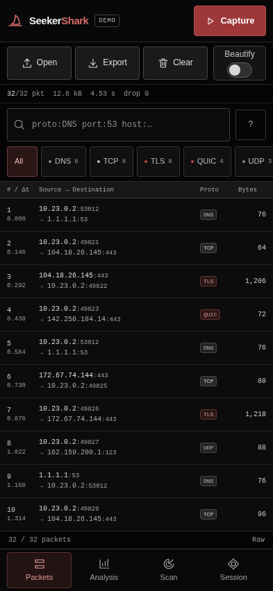
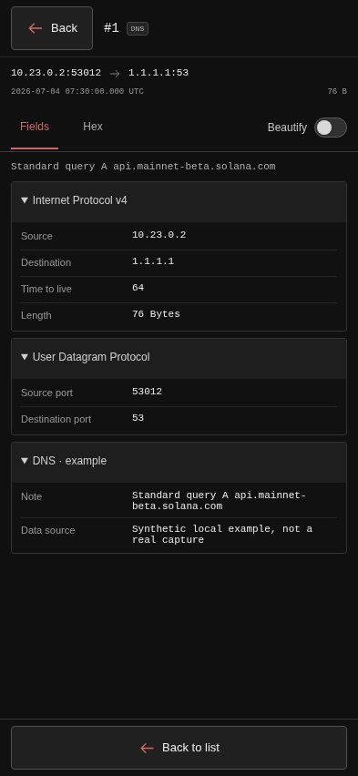
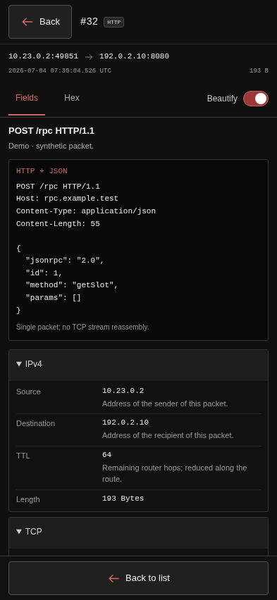
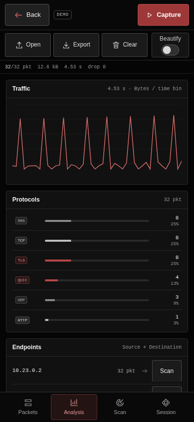
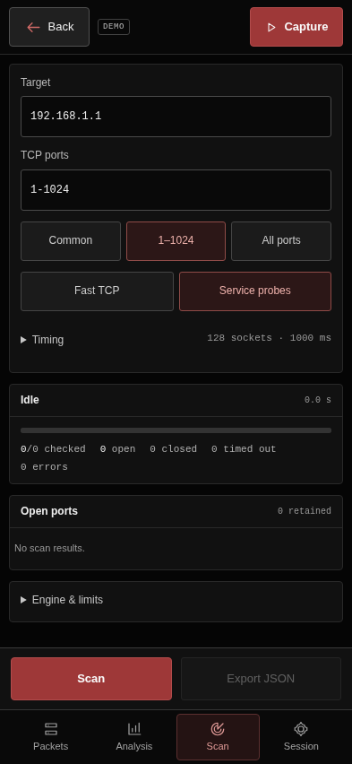
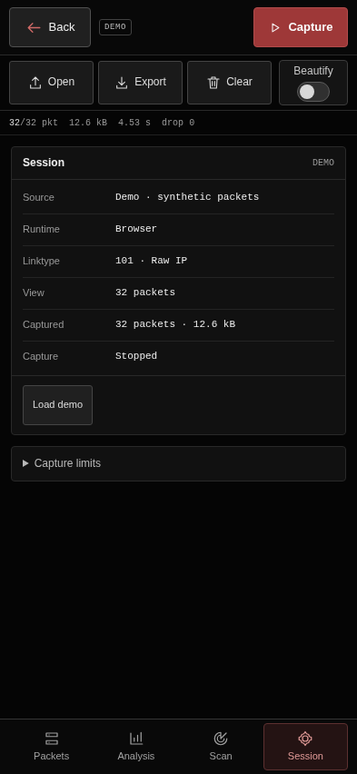
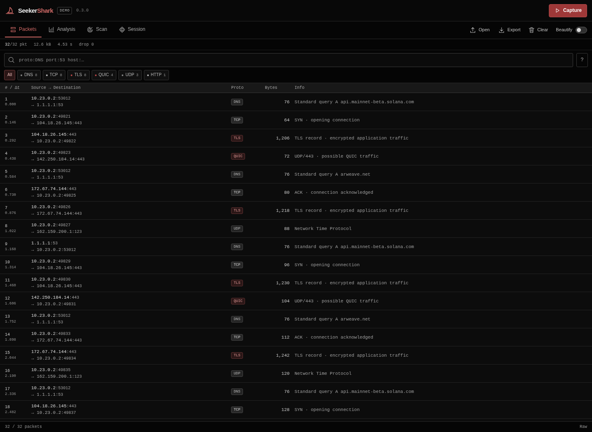

# SeekerShark screenshots

Version 0.3.0: native TCP scanner tab, English interface, larger labeled mobile controls, fixed Back buttons, black background, matte red, and gray/white text. These screenshots show the actual browser UI with labeled synthetic demo packets. They were not captured on an Android device.

## Mobile packet list

[Download PNG](mobile-packets.png)

## Packet details

[Download PNG](mobile-packet-detail.png)

## Beautify enabled

[Download PNG](mobile-beautify.png)

## Mobile analysis

[Download PNG](mobile-analysis.png)

## Mobile scanner

[Download PNG](mobile-scan.png)

The scanner screenshot shows idle configuration. No scan was performed by the browser and no scan results are fabricated.

## Mobile session

[Download PNG](mobile-session.png)

## Desktop view

[Download PNG](desktop-packets.png)

